  

  

  <a href="https://jyothiranand.com">Portfolio</a>
  &nbsp;|&nbsp;
  <a href="./Jyothiranand_S_CV.pdf">CV</a>
  &nbsp;|&nbsp;
  <a href="mailto:jyothiranands@gmail.com">Email</a>
  &nbsp;|&nbsp;
  Pune, India

 

I build TypeScript backends with **Express** and **Hono**, and the **Next.js** apps that sit on top of them. Six months shipping SaaS at **Axium Studios** across freight logistics and healthcare, including LLM powered features and agent style workflows.

Two full stack products are public with READMEs, demo data, and Docker setup.

## Stack

  

  
  
  
  
  
  

**Languages:** TypeScript, JavaScript, Python, SQL  
**Frontend:** Next.js, React  
**Backend:** Express, NestJS, Node.js, Hono, REST APIs  
**Data:** PostgreSQL, MySQL, Prisma  
**AI:** LLM API integrations, agent style workflows  
**Tools:** Git, Docker, Podman, AWS (foundational)

## Selected work

### [Ternline](https://github.com/Spydero/Freight-SaaS) | freight logistics console

Leads to quotes to approved clients to shipment milestones, kanban, analytics, and public tracking links.

  

- Modular Express API (auth, leads, quotes, shipments, notifications, admin)
- Cookie sessions with JWT, bcrypt, and role based access for ops / admin / client
- pnpm monorepo with shared Zod schemas; Docker Compose for local runs

### [Nora](https://github.com/Spydero/nora) | evidence cited health guidance

Symptom guidance where urgency is rule based; the LLM only drafts language, and every claim stays citeable.

  

- Rule based triage; emergencies short circuit before any model call
- Verifier rejects uncited claims, diagnosis, or dosing language, then falls back to approved templates
- OpenRouter primary with Gemini fallback; audit trails and CSRF protected auth

### Internship | Axium Studios LLP *(Mar to Sep 2026)*

End to end SaaS features connecting Next.js workflows to TypeScript APIs and relational models. Private client code; walkthroughs available on request.

- Freight logistics SaaS: shipment ops and tracking (Next.js, Express, Prisma, PostgreSQL)
- Healthcare AI SaaS: product UI on NestJS with LLM and agent style workflows

## Contact

- Portfolio: [jyothiranand.com](https://jyothiranand.com)
- CV: [Jyothiranand_S_CV.pdf](./Jyothiranand_S_CV.pdf)
- Email: [jyothiranands@gmail.com](mailto:jyothiranands@gmail.com)

Open to full time backend or full stack roles.
